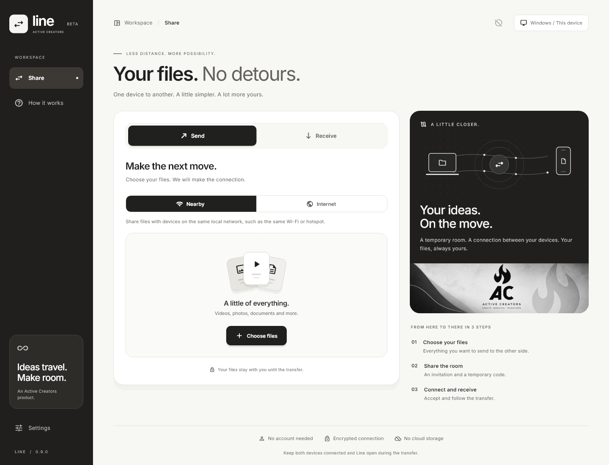
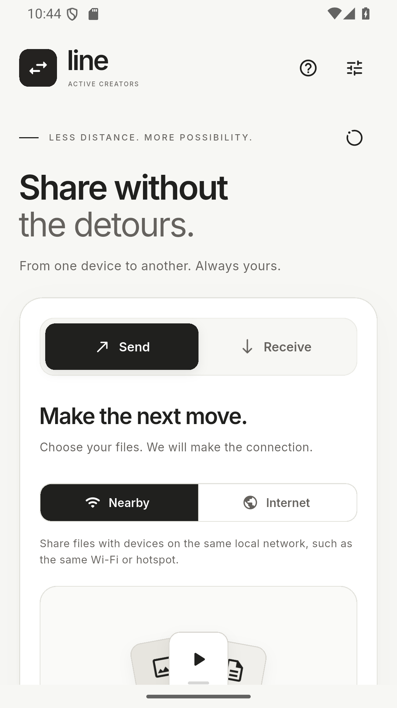
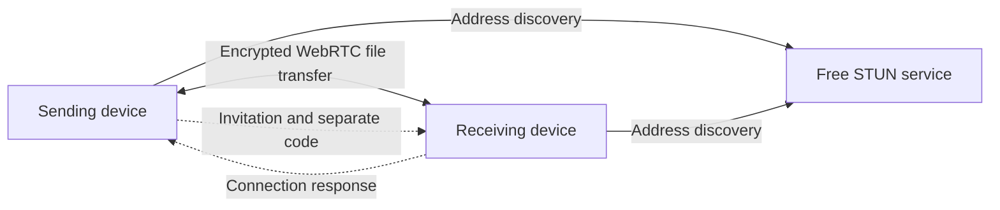

<div align="center">
  
  <h1>Line</h1>
  <p><strong>Direct file sharing between Windows and Android.</strong></p>
  <p>An open-source app by Active Creators.</p>
  <p>
    <a href="LICENSE"></a>
    
    
    <a href="https://github.com/activecreatorsoficial-del/Line/releases/tag/v0.9.0"></a>
  </p>
  <p>
    <a href="https://github.com/activecreatorsoficial-del/Line/releases/tag/v0.9.0">Download</a> ·
    <a href="#how-to-use-line">How to use</a> ·
    <a href="#build-from-source">Build from source</a> ·
    <a href="CONTRIBUTING.md">Contribute</a>
  </p>
</div>



## What is Line?

Line lets you choose files on one device and send them directly to another. The sending device keeps a temporary sharing session open, and the receiver saves a local copy. Files travel through an encrypted WebRTC DataChannel while both devices show transfer progress.

Use **Nearby** when both devices are on the same local network. Use **Internet** to exchange an invitation and a response, then let the devices try to establish a direct connection across networks.

Line is built for sending large files with bounded memory use. It streams small chunks to disk and checks each completed file with SHA-256. Practical capacity depends on the devices, available storage and connection quality.

## Download

The current preview is **0.9.0**. Update both devices before using the new Internet exchange.

| Platform | Download | Requirements |
| --- | --- | --- |
| Windows installer | [Line-Setup-0.9.0.exe](https://github.com/activecreatorsoficial-del/Line/releases/download/v0.9.0/Line-Setup-0.9.0.exe) | Windows 10 or later, x64 |
| Windows portable | [Line-Windows-portable.zip](https://github.com/activecreatorsoficial-del/Line/releases/download/v0.9.0/Line-Windows-portable.zip) | Extract the whole folder and run line.exe |
| Android | [Line-Android-0.9.0-preview.apk](https://github.com/activecreatorsoficial-del/Line/releases/download/v0.9.0/Line-Android-0.9.0-preview.apk) | Android 7.0 / API 24 or later |

Close Line before updating. On Android, allow installation from the source used to open the APK. Windows preview binaries are unsigned and may trigger SmartScreen. The Android preview uses a development signing identity. The release includes SHA-256 checksums for the downloadable files.

## How to use Line

### Nearby

1. Connect both devices to the same local network, such as the same Wi-Fi or hotspot. A PC connected by Ethernet can share the local network with a phone using Wi-Fi.
2. On the sending device, select **Send → Nearby**, choose your files and create a sharing room.
3. Privately send the full invitation and the separate **eight-digit code** to the receiver.
4. On the receiving device, select **Receive**, paste the invitation and code, and join the room.
5. Compare the security codes on both screens through an independent trusted channel. The receiver then selects **Accept and receive**.

### Internet

1. On the sending device, select **Send → Internet**, choose your files and create a sharing room.
2. Privately send the invitation and the separate **12-digit code** to the receiver.
3. The receiver opens **Receive**, pastes the invitation and code, and joins.
4. The receiver selects **Copy response** and sends that response back to the sender.
5. The sender pastes it into **Connection response** and selects **Connect devices**.
6. Compare the security codes through an independent trusted channel, then accept the transfer.

Keep both apps open and return the response promptly. Invitations expire after ten minutes. Create a fresh room if either device changes networks or a connection attempt times out. Copy the complete invitation and response. For messages that exceed your chat service's text limit, use a private text attachment.

<details>
<summary><strong>See the Android interface</strong></summary>
<br>

</details>

## How the connection works

Nearby runs a temporary encrypted room service on the sending device. The invitation contains the connection details and a certificate pin. Once the handshake completes, WebRTC carries the file transfer.

Internet carries the encrypted connection details in the invitation and response. Free public STUN discovery helps both devices find usable connection addresses. The selected files stay on the sending device until the receiver accepts and saves a copy.



The current Internet mode uses Cloudflare's public STUN endpoint. Its documented free service works without an account or billing credentials. Provider availability and terms can change. Internet access uses each device's existing data plan. [Cloudflare STUN FAQ](https://developers.cloudflare.com/realtime/turn/faq/)

## Current capabilities and limits

| Area | Current behavior |
| --- | --- |
| Platforms | Native Flutter app for Windows x64 and Android API 24+ |
| Files | Up to 50 files per session, streamed in 16 KiB chunks with bounded buffering |
| Integrity | Incremental SHA-256 verification before completing received files |
| Security | Encrypted DataChannels, temporary invitations and code comparison before acceptance |
| Internet signaling | Encrypted invitation and response, with free public STUN discovery |
| Android storage | Private app storage first, then export a copy to a chosen folder. Allow space for both copies |
| Background use | Android foreground sharing notification during active sessions. System and manufacturer battery policies still apply |

**Internet connectivity is experimental.** Routers, CGNAT, VPNs, mobile providers and firewalls can prevent a direct route. This preview has no default relay fallback. Test coverage includes Windows and Android native transfers and separate-process transfers in both directions. A physical transfer between two unrelated Internet connections remains unverified in the recorded release tests.

The protocol's 8 TiB per-file metadata ceiling is a validation limit. Actual multi-gigabyte performance still needs physical-device measurement. Share invitations and codes privately, and compare the security codes before accepting files. [Verification record](VERIFICATION.md), [security policy](SECURITY.md)

## Build from source

The recorded builds use **Flutter 3.47.1 stable** and **Dart 3.13.1**. Install the Windows or Android tooling reported by flutter doctor for your target. Windows builds require Visual Studio C++ desktop tooling. Android builds require the Android SDK and JDK 17 or later.

```sh
git clone https://github.com/activecreatorsoficial-del/Line.git
cd Line
flutter doctor
flutter pub get
flutter analyze
flutter test
```

Build your target from the main entrypoint. Run Flutter builds sequentially.

```sh
flutter build windows --release -t lib/main.dart
flutter build apk --release -t lib/main.dart
```

The Windows installer can be packaged from PowerShell after its release build.

```powershell
powershell -NoProfile -ExecutionPolicy Bypass -File tools/package-windows.ps1 -SkipBuild
powershell -NoProfile -ExecutionPolicy Bypass -File tools/verify-installer.ps1
```

The app uses the native room implementation for Nearby and invitation exchange for Internet. server/ preserves an earlier Node signaling prototype for reference. Detailed architecture, native integration tests and cross-device verification are documented separately. [Development guide](docs/DEVELOPMENT.md)

## Project layout

| Path | Purpose |
| --- | --- |
| lib/core/ | Connections, invitations, native room hosting and streamed transfers |
| lib/ui/ | Visual identity, motion and transfer components |
| android/ | Android platform integration and foreground sharing service |
| windows/ | Windows native runner and app resources |
| test/ | Unit tests, widget tests and Windows visual reference images |
| integration_test/ | Native end-to-end file-transfer checks |
| tools/ | Packaging, installer checks and cross-device test helpers |
| docs/ | Development notes and screenshots |

## Contributing

Bug reports, reproducible networking cases, usability feedback and focused pull requests are welcome. Include the app version, both operating systems and the selected sharing mode when reporting a connection problem. [Contribution guide](CONTRIBUTING.md), [report an issue](https://github.com/activecreatorsoficial-del/Line/issues)

## License and credits

Copyright © 2026 Active Creators. Line's original source code is licensed under MIT. The bundled Inter font and other third-party components retain their own license notices. [MIT license](LICENSE), [third-party notices](THIRD_PARTY_NOTICES.md)
